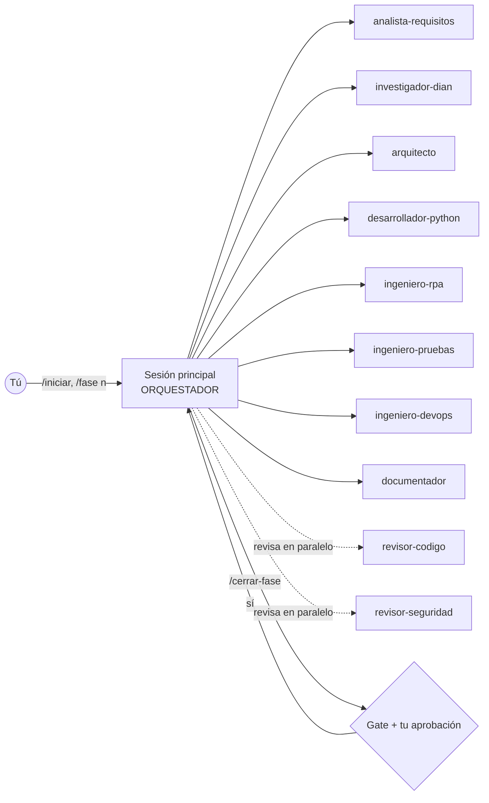

# Consulta automatizada del estado del RUT — proyecto guiado por agentes de Claude Code

Este repositorio todavía **no tiene código de la aplicación**: contiene el sistema de agentes, skills,
specs, comandos y hooks para que Claude Code la construya por fases, con aprobación humana entre fases.

## 1. Prerrequisitos (Windows)

| Herramienta | Para qué | Instalación |
|---|---|---|
| Node.js ≥ 18 | Claude Code y servidores MCP | nodejs.org (LTS) |
| Claude Code | Orquestación | `npm install -g @anthropic-ai/claude-code` |
| uv | Python, dependencias y **ejecución de los hooks** | `powershell -c "irm https://astral.sh/uv/install.ps1 \| iex"` |
| Git (incluye Git Bash) | Control de versiones y shell de Claude Code en Windows | git-scm.com |

> Los hooks se invocan con `uv run --no-project python ...`. Sin `uv` los hooks no se ejecutan y
> los guardarraíles quedan desactivados: instala `uv` antes de empezar.

## 2. Arranque

```powershell
cd consulta-rut-dian
copy .env.example .env          # ajusta valores luego; los agentes no pueden leerlo
claude                          # abre Claude Code en la carpeta
```

Dentro de Claude Code:

1. Aprueba los servidores MCP del proyecto (`context7`, `playwright`) cuando lo pregunte. Verifica con `/mcp`.
2. Revisa los hooks con `/hooks` y los agentes con `/agents`.
3. Ejecuta **`/iniciar`**. Desde ahí el orquestador lleva el proyecto fase a fase.

## 3. Cómo trabaja el sistema



- **Autónomo dentro de cada fase**: los agentes investigan, diseñan, programan con TDD, prueban y se revisan entre sí.
- **Humano entre fases** (`/cerrar-fase`): las instrucciones del proyecto exigen validar requisitos, viabilidad legal y pruebas antes de avanzar. Esto no se puede delegar a los agentes.
- **Humano en la consulta real**: si el canal de la DIAN presenta captcha/Turnstile, la aplicación pausa y el operador lo resuelve en el navegador visible. Nunca se resuelve automáticamente.

## 4. Inventario

| Tipo | Ubicación | Contenido |
|---|---|---|
| Memoria del proyecto | `CLAUDE.md` | Rol de orquestador, reglas no negociables, stack, convenciones |
| Specs | `specs/` | `SPEC.md` (maestra), `requisitos.md`, `criterios-aceptacion.md`, `excepciones.md`, `tareas.md` (backlog T-01…T-65) |
| Estado | `docs/ESTADO.md` | Fase, gates, decisiones, supuestos, riesgos, bitácora |
| ADR | `docs/adr/0001-stack-tecnologico.md` | Comparación PAD / UiPath / Selenium / Playwright / HTTP |
| Agentes (10) | `.claude/agents/` | analista-requisitos, investigador-dian, arquitecto, desarrollador-python, ingeniero-rpa, ingeniero-pruebas, revisor-codigo, revisor-seguridad, ingeniero-devops, documentador |
| Skills (6) | `.claude/skills/` | metodologia-fases, cumplimiento-dian, playwright-rpa, proteccion-datos-co, python-arquitectura, validacion-identificacion |
| Comandos (7) | `.claude/commands/` | `/iniciar`, `/fase`, `/investigar-dian`, `/implementar`, `/revisar`, `/cerrar-fase`, `/estado` |
| Hooks (5) | `.claude/hooks/` + `.claude/settings.json` | ver abajo |
| MCP | `.mcp.json` | Context7 (documentación vigente) y Playwright MCP (observación del portal) |

### Hooks

| Evento | Hook | Qué hace |
|---|---|---|
| SessionStart | `contexto_sesion.py` | Inyecta fase actual, tareas abiertas y reglas críticas |
| PreToolUse | `bloquear_evasion.py` | Bloquea instalar/usar stealth, solucionadores de captcha, `navigator.webdriver`, endpoints JSF internos y `curl` a la DIAN |
| PreToolUse | `proteger_datos.py` | Bloquea leer `.env`, editar hooks/settings, escribir en `data/ output/ logs/`, ids con apariencia real en código y logs sin enmascarar |
| PostToolUse | `formatear_python.py` | `ruff format` + `ruff check --fix` al archivo editado; devuelve errores restantes |
| Stop | `verificar_pruebas.py` | Si cambió `src/` o `tests/`, corre la suite offline; si falla, Claude debe corregir antes de terminar |

Los agentes **no pueden** modificar `.claude/hooks/` ni `.claude/settings.json`: los cambias tú.

## 5. Decisión sobre las herramientas sugeridas (resumen del ADR-0001)

**Recomendado: Python + Playwright**, con la fuente de datos detrás de un puerto intercambiable.

- **Power Automate Desktop / UiPath**: se descartan *para este proyecto construido por agentes*: sus flujos se crean en editores gráficos, así que los agentes no pueden escribirlos, ejecutarlos ni probarlos desde la terminal. Las specs, estados y selectores son reutilizables si la empresa exige su RPA corporativo.
- **Selenium**: funciona, pero Playwright ofrece espera automática, locators más estables, `pytest-playwright` y un servidor MCP que los agentes usan para observar el portal.
- **HTTP directo (requests)**: descartado: empuja a usar endpoints internos no documentados.
- La decisión queda **PROPUESTA** hasta que la Fase 2 confirme que existe un canal oficial utilizable. Si aparece una API oficial o se elige un proveedor, Playwright pasa a ser opcional.

## 6. Referencias usadas para el diseño

- Formatos de agentes, comandos y hooks: repositorio oficial `anthropics/claude-code` (plugins `plugin-dev`), consultado vía Context7.
- Playwright MCP: `microsoft/playwright-mcp` (configuración `.mcp.json`, `--isolated`).
- Plantillas comunitarias de agentes/comandos: `davila7/claude-code-templates`.
- Enfoque spec-driven (specs → plan → tareas): GitHub `spec-kit`.
- Herramientas comerciales que hoy automatizan el portal público (Kontalid, ConsultorContable, Actualícese): evidencia del mercado para la Fase 2, no código reutilizable.
