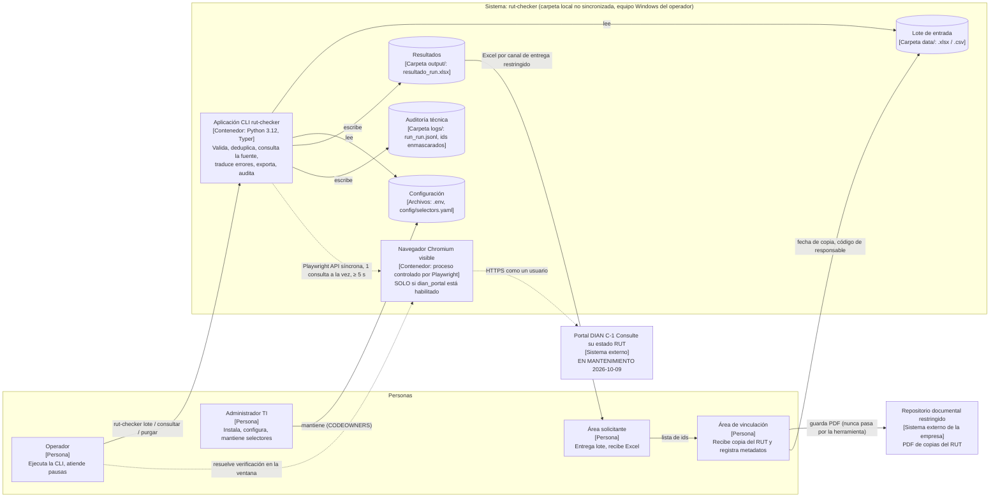
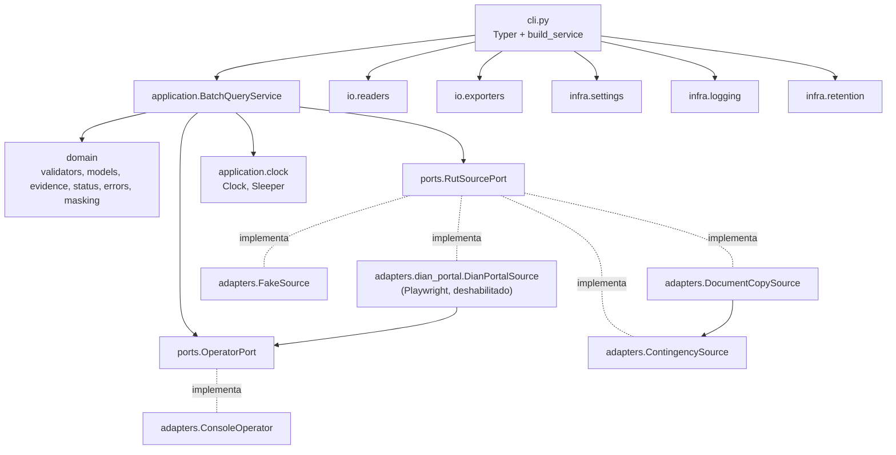
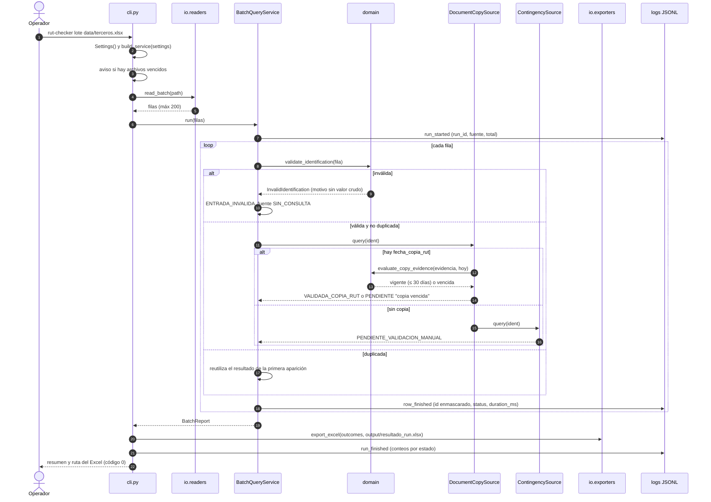
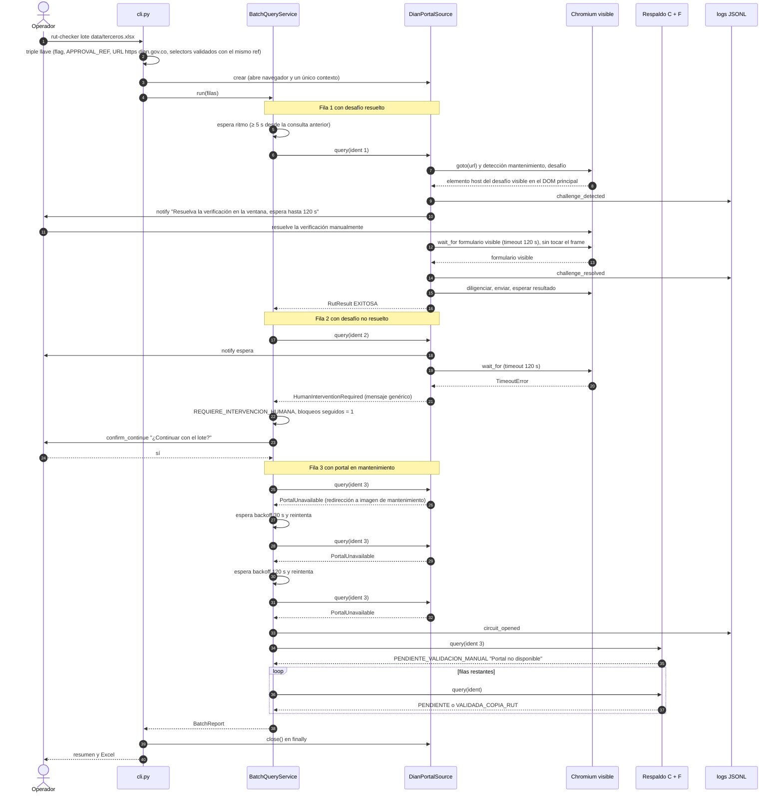

# Arquitectura — Consulta automatizada del estado del RUT

> Fase 3 (T-23) · arquitecto · 2026-10-09 · Estado: **LISTA PARA GATE** — decisiones D-1..D-5 y P-4 del
> usuario y 15 observaciones de `revisor-seguridad` (APROBADO CON OBSERVACIONES, 0 bloqueantes) incorporadas.
> Decisiones: ADR-0001 (stack), ADR-0002 (puerto y adaptadores), ADR-0003 (modo asistido).
> Convención: [CONFIRMADO] · [PENDIENTE] · [DESCARTADO] · [SUPUESTO] · **Obs-n** = observación de seguridad n.

## 1. Principios

1. **Lo mínimo suficiente:** un proceso CLI local que lee un archivo y escribe un Excel. Sin base de
   datos, sin colas, sin servicio web, sin programador de tareas.
2. **C + F ahora, E condicionado** (INFORME §8): el modo base no necesita navegador; el adaptador del
   portal existe pero está deshabilitado y falla de forma segura (triple llave, ADR-0002 §3).
3. **Cada componente se justifica con un requisito** (tabla §3). Lo que no tiene requisito no se diseña (§12).
4. **Dependencias:** `cli → application → ports ← adapters`; `domain` solo usa stdlib, pydantic y stdnum.
   Playwright solo en `adapters/dian_portal/`.
5. **Un único lugar traduce excepción → `QueryStatus`:** `BatchQueryService`.
6. **Datos personales:** ids enmascarados en logs y mensajes; datos reales solo en `data/` y `output/`
   (fuera de git); el PDF de la copia del RUT nunca entra a la herramienta; nunca se registran textos de
   excepciones de terceros.

## 2. C4 — Contexto y contenedores (nivel 2)

Se usa `flowchart` de Mermaid (más portable que la sintaxis experimental `C4Container`) con la notación C4.



Líneas punteadas = ruta **deshabilitada por defecto** (E). Portal en mantenimiento [CONFIRMADO 2026-10-09 14:20:55 COT].

### 2.1 Componentes del contenedor CLI (nivel 3, resumido)



## 3. Justificación de componentes

| Componente | Responsabilidad | Requisitos |
|---|---|---|
| `domain/validators.py` | Normalizar, validar longitud y DV (stdnum) | RF-03, RN-01, RN-02 |
| `domain/models.py` | `IdentificationInput`, `CopyEvidence`, `RutResult`, `QueryOutcome` (inmutables) | RF-05, RNF-04, RNF-07 |
| `domain/evidence.py` | Regla de la copia ≤ 30 días → `VALIDADA_COPIA_RUT` | RN-07, D-1 |
| `domain/status.py` | `QueryStatus`, `SourceKind` | RF-08 |
| `domain/errors.py` | Jerarquía `RutCheckerError` con mensajes genéricos sin ids | RF-08, RNF-01 |
| `domain/masking.py` | `mask_identification()`, `mask_digit_runs()` | RNF-01 |
| `ports/rut_source.py`, `ports/operator.py` | Contratos de fuente y de operador | SPEC §3, RF-10 |
| `application/batch_service.py` | Validar, deduplicar, ritmo, reintentos, respaldo, circuito, paradas, traducción a `QueryStatus` | RF-02, RF-08, RF-09, RF-11, RF-12, RNF-02 |
| `ports/clock.py`, `application/clock.py` | `Clock` es un puerto (los adaptadores lo usan sin importar `application`); `Sleeper` y el reloj de sistema viven en application (T-35); pruebas sin espera real | RNF-05 |
| `adapters/contingency_source.py` | Fila pendiente de validación manual | RF-12 (F) |
| `adapters/document_copy_source.py` | Registro de metadatos de la copia | RN-07 (C) |
| `adapters/fake_source.py` | Fuente programable para pruebas (`build_service` exige `RUT_ALLOW_FAKE`; el adaptador no lo comprueba) | RNF-05 |
| `adapters/console_operator.py` | Avisos y confirmaciones en terminal | RF-10 |
| `adapters/dian_portal/*` | RPA asistido (E), deshabilitado | RF-04, RF-05, RF-10, RNF-03, RNF-07 |
| `io/readers.py` | Leer `.xlsx` y `.csv` desde `data/` | RF-01, RF-02 |
| `io/exporters.py` | Escribir `.xlsx` (Must) neutralizado; JSON de respaldo; JSON/CSV *Could* | RF-06, RNF-01 |
| `infra/settings.py` | Variables `RUT_*` con límites y valores seguros | RNF-01, RNF-02 |
| `infra/logging.py` | Log JSONL con filtro de enmascarado | RF-07, RNF-01 |
| `infra/paths.py` | Restringir rutas de salida a `RUT_OUTPUT_DIR` | RNF-01 (Obs-4) |
| `infra/retention.py` + comando `purgar` | Eliminar datos, resultados, logs y snapshots vencidos | RN-06 |
| `config/selectors.yaml` | Selectores fuera del código | RNF-03 |

## 4. Estructura de paquetes

```
pyproject.toml                    # uv; [project.scripts] rut-checker = "rut_checker.cli:app"
                                  # extra opcional "portal" = playwright + pyyaml (ADR-0001); defusedxml en base
config/selectors.yaml             # placeholders PENDIENTE, validated: false (hasta T-14)
.github/CODEOWNERS                # propuesto: config/selectors.yaml y .env.example con revisión humana
src/rut_checker/
  __init__.py
  cli.py                          # Typer(pretty_exceptions_show_locals=False): consultar, lote, purgar · build_service
  domain/                         # stdlib + pydantic + stdnum. Nada más.
    status.py                     # QueryStatus(StrEnum), SourceKind(StrEnum)
    errors.py                     # RutCheckerError y subclases (§7)
    masking.py                    # mask_identification(), mask_digit_runs()
    validators.py                 # normalize_identification(), validate_identification()
    models.py                     # IdentificationInput, CopyEvidence, RutResult, QueryOutcome
    evidence.py                   # MAX_COPY_AGE_DAYS = 30, evaluate_copy_evidence()
  ports/
    rut_source.py                 # RutSourcePort(Protocol)
    operator.py                   # OperatorPort(Protocol)
    clock.py                      # Clock(Protocol): now() aware y today() en America/Bogota
  application/
    clock.py                      # Sleeper (Protocol) + SystemClock (implementación de sistema, T-35)
    retry_policy.py               # RetryPolicy: qué excepciones, cuántos intentos, backoff, umbrales de circuito
    batch_service.py              # BatchQueryService
  adapters/
    contingency_source.py
    document_copy_source.py
    fake_source.py
    console_operator.py
    dian_portal/                  # ÚNICO paquete que importa playwright
      __init__.py
      selectors.py                # carga (yaml.safe_load) + validación Pydantic (triple llave, rechaza synthetic)
      detection.py                # is_maintenance, find_challenge, find_block, assert_structure
      page.py                     # DianQueryPage: navegar, diligenciar, enviar, leer
      extractor.py                # locators → RawPortalResult (sin lógica de negocio)
      snapshot.py                 # esqueleto estructural endurecido (D-5), desactivado por defecto
      source.py                   # DianPortalSource(RutSourcePort) + pausa asistida
  io/
    readers.py                    # read_batch(path) -> list[InputRow]
    exporters.py                  # export_excel(...), export_json_backup(...), neutralize_cell(...)
  infra/
    settings.py                   # Settings(BaseSettings, env_prefix="RUT_")
    logging.py                    # configure_logging(run_id, log_dir) + MaskingFilter
    paths.py                      # resolve_output_path(), assert_not_in_git_tree()
    retention.py                  # find_expired(...), purge(...)
tests/
  conftest.py                     # guard de red autouse (Obs-6)
  unit/ integration/ e2e/
  fixtures/html/sintetico/        # fixtures de MECANISMO (D-4), marcados "SINTÉTICO"
  fixtures/html/                  # fixtures del portal real: BLOQUEADOS por T-14 (T-51)
  fixtures/selectors_test.yaml    # synthetic: true (el loader de producción lo rechaza)
```

Pruebas de arquitectura con `ast` (T-30, extendida en T-49):
- `domain`, `ports` y `application` no importan `playwright`, `typer`, `openpyxl`, `yaml` ni
  `rut_checker.adapters|io|infra`.
- `adapters/dian_portal/` no usa `user_agent`, `proxy`, `args`, `ignore_default_args`, `add_init_script`,
  `extra_http_headers`, `route`, `ignore_https_errors`, `clear_cookies`, `frame_locator`, `content_frame`,
  `.pause(`, `tracing`, `record_video_dir`, `record_har_path`, `screenshot`, ni `new_context` fuera de la
  función de inicio del lote (ADR-0003 §3).

## 5. Modelo de datos

### 5.1 Enumeraciones

`QueryStatus` (catálogo de `specs/excepciones.md`): `EXITOSA`, `SIN_RESULTADOS`, `ENTRADA_INVALIDA`,
`PORTAL_NO_DISPONIBLE`, `TIEMPO_AGOTADO`, `ESTRUCTURA_CAMBIADA`, `RESULTADO_INCOMPLETO`, `SESION_VENCIDA`,
`REQUIERE_INTERVENCION_HUMANA`, `PENDIENTE_VALIDACION_MANUAL`, **`VALIDADA_COPIA_RUT`** (D-1),
`ERROR_EXPORTACION`. `ERROR_ALMACENAMIENTO` no se implementa (no hay BD).

`SourceKind` (columna `fuente`): `PORTAL_DIAN_C1`, `COPIA_RUT_TERCERO`, `CONTINGENCIA_MANUAL`,
`SIN_CONSULTA` (filas `ENTRADA_INVALIDA`), `FAKE` (pruebas).

### 5.2 Entrada (`io/readers.py`) — archivos en `data/`

| Columna | Obligatoria | Formato | Uso |
|---|---|---|---|
| `identificacion` | Sí | Texto o número; Excel puede traer `1000000001.0` | RF-01/02 |
| `dv` | No | 1 dígito. También se acepta `900000001-7` en `identificacion` | RN-02 |
| `fecha_copia_rut` | No | `AAAA-MM-DD` o fecha de Excel | RN-07 (C) |
| `responsable_validacion` | Si hay `fecha_copia_rut` | **Código o usuario** `^[A-Za-z0-9._-]{2,40}$` (p. ej. `USR-001`), no nombre completo (Obs-8) | RN-07 (C) |
| `observacion` | No | Texto libre, máx. 200 caracteres; nunca se registra en log | RN-07 |

- Entrada = solo el número, DV opcional, sin columna de tipo CC/NIT (P-4 [CONFIRMADO 2026-10-09]).
- Encabezados sin distinguir mayúsculas ni tildes; primera hoja del `.xlsx`; CSV `utf-8-sig` con `,` o `;`.
- `openpyxl` con `defusedxml` instalado (protección XML, ADR-0001).
- Falta `identificacion` o el lote supera `RUT_MAX_BATCH_SIZE` → error de archivo, código 2, sin procesar.
- `fecha_copia_rut` ilegible, responsable inválido u observación > 200 → fila `ENTRADA_INVALIDA` con motivo.
- `InvalidIdentification.reason` describe la regla incumplida ("contiene caracteres no numéricos",
  "longitud fuera de rango", "DV incorrecto") y **nunca** incluye el valor crudo (Obs-7).
- [SUPUESTO] Longitudes: cédula 3–10 dígitos, NIT 9–10 sin DV (skill `validacion-identificacion`).
- Espacios: al inicio/fin y alrededor del guion del DV son formato; entre dígitos solo como miles
  bien agrupados (`1 000 000 001`) y sin `.`/`,`. El DV nunca se separa con espacio
  (`900000001 7` → `ENTRADA_INVALIDA`, "contiene caracteres no numéricos").
- **Posible NIT con DV pegado:** `validate_identification` marca `IdentificationInput.possible_glued_check_digit`
  cuando la identificación tiene 10 dígitos, empieza por 8 o 9, no llegó DV y `calc_check_digit(n[:9]) == n[9]`.
  No se adivina. `BatchQueryService` (T-35) debe enviar esas filas a `PENDIENTE_VALIDACION_MANUAL` con la
  observación "posible NIT con DV pegado" **sin consultar la fuente**.

### 5.3 Salida (SPEC §5, exactamente estas columnas y en este orden)

| Columna | Origen | Notas |
|---|---|---|
| `identificacion` | Número normalizado (o el valor crudo si es `ENTRADA_INVALIDA`) | Se escribe **como texto**; dato personal: solo en `output/` |
| `dv` | **Solo de la entrada** (`IdentificationInput.dv`, o `InputRow.raw_dv` si la fila es inválida); ninguna fuente lo aporta | Vacío si no aplica |
| `nombre_o_razon_social` | Solo `PORTAL_DIAN_C1` | **Vacío** en C (D-3) y F |
| `estado_rut` | Solo `PORTAL_DIAN_C1`, texto tal cual lo muestre el portal (RN-03) | **Vacío** en C (D-3) y F; nunca se inventa |
| `fecha_consulta` | `Clock.now()` en `America/Bogota`, ISO 8601 con desfase | Fecha de procesamiento de la fila |
| `fuente` | Siempre `RutResult.source` (`SourceKind`); `RutSourcePort.kind` solo identifica al adaptador | RNF-04 |
| `estado_consulta` | `QueryStatus` | RF-08 |
| `observacion` | Mensaje del catálogo + motivo; en C: "Validado contra copia del RUT de fecha AAAA-MM-DD; responsable: USR-001" + observación del área (también en copia vencida/futura; espacios colapsados, números largos enmascarados) | Sin id completo |

- Una fila por fila de entrada, en el orden original, incluidas duplicadas e inválidas (G7).
- Archivo `output/resultado_<run_id>.xlsx`, hoja `resultado`. `run_id = AAAAMMDD-HHMMSS-<4 hex>` (sin ids).
- **Neutralización (Obs-9):** toda celda de texto que empiece por `=`, `+`, `-`, `@`, tabulador o retorno
  de carro se prefija para que Excel la trate como texto. Aplica también a CSV/JSON (T-47).

### 5.4 Modelos de dominio (T-42, `domain/models.py`)

- **`InputRow`** (vive en `domain`; la produce `io/readers`): fila cruda (`row_index` y valores `raw_*`
  como texto sin validar). Permite representar filas inválidas sin construir un `IdentificationInput`.
  `repr` enmascara `raw_identification` y oculta el resto.
- **`IdentificationInput`**: entrada ya normalizada y válida en formato (T-41 normaliza y valida longitud/DV).
- **`QueryOutcome`**: `row: InputRow` + `identification: IdentificationInput | None` + `result` +
  `queried_at` + `duration_ms`. `identification` es `None` solo si el estado es `ENTRADA_INVALIDA`
  (fuente `SIN_CONSULTA`). La zona horaria de `queried_at` la fija el `Clock` (T-35).
- **`CopyVerdict`** (`VALID`, `EXPIRED`, `FUTURE_DATE`): `evaluate_copy_evidence` no lanza por fecha futura;
  `DocumentCopySource` la traduce a `PENDIENTE_VALIDACION_MANUAL` "fecha de copia inválida" con
  `RutResult.source = CONTINGENCIA_MANUAL` (igual que la copia vencida; sin invocar el fallback).
- Invariantes de `RutResult`: `VALIDADA_COPIA_RUT` => fuente `COPIA_RUT_TERCERO` y sin estado/nombre;
  `ENTRADA_INVALIDA` => `SIN_CONSULTA`; `estado_rut`/`name` solo con `PORTAL_DIAN_C1` o `FAKE`
  (incumplirlos es error de programación). `EXITOSA` sin `estado_rut` => `IncompleteResult` (dato).

## 6. CLI

| Comando | Descripción | Código de salida |
|---|---|---|
| `rut-checker lote <archivo> [--salida DIR]` | Procesa el lote y escribe el Excel | 0 completo · 1 lote detenido · 2 error de entrada/config · 3 error de exportación |
| `rut-checker consultar [--dv D] [--fecha-copia AAAA-MM-DD --responsable USR]` | Lote de 1 fila. El número se pide por **prompt** si no se pasa como argumento (evita el historial de PowerShell, Obs-11); imprime resumen con id enmascarado y escribe el Excel | igual |
| `rut-checker purgar [--confirmar] [--fuente PORTAL_DIAN_C1]` | Lista (o elimina con `--confirmar`) lo vencido en `data/`, `output/`, `logs/` | 0 / 2 |

- `--salida` debe resolverse **dentro de** `RUT_OUTPUT_DIR`; si no → código 2. `RUT_OUTPUT_DIR`,
  `RUT_LOG_DIR` y `RUT_DATA_DIR` se rechazan si quedan dentro de un árbol git, **salvo** las carpetas
  por defecto `output/`, `logs/` y `data/` de la raíz del proyecto (cubiertas por `.gitignore`) (Obs-4).
- El JSON de respaldo de `ERROR_EXPORTACION` se escribe siempre en `RUT_OUTPUT_DIR`.
- Al iniciar `lote` o `consultar`, si hay archivos vencidos se imprime un aviso "Hay N archivos con más de
  365 días: ejecute `rut-checker purgar`" (Obs-10).
- `--formato json|csv` solo si se implementa el *Could* de RF-06 (T-47).

## 7. Errores y traducción a `QueryStatus`

Excepciones de dominio (`domain/errors.py`) con **mensajes genéricos**; nunca contienen el id, el valor
crudo ni el texto de una excepción de terceros (Obs-3, Obs-7):

| Excepción | Quién la lanza | `QueryStatus` | Reintento (servicio) | Efecto en el lote |
|---|---|---|---|---|
| `InvalidIdentification(reason)` | validators / evidence | `ENTRADA_INVALIDA` | No | La fuente no se invoca |
| `PortalUnavailable` | dian_portal (mantenimiento, 5xx, red) | `PORTAL_NO_DISPONIBLE` → al agotar: **respaldo** | Sí, `RUT_MAX_RETRIES` (2), backoff `RUT_RETRY_BACKOFF_S` (30, 120) | Circuito abierto: resto del lote al respaldo |
| `QueryTimeout` | dian_portal | `TIEMPO_AGOTADO` | Sí, máx. 2, mismo backoff | **3 seguidos → circuito abierto** (constante, Obs-13) |
| `SessionExpired` | dian_portal | `SESION_VENCIDA` | Sí, 1, el adaptador abre **página nueva** (único caso) | — |
| `StructureChanged` | dian_portal (incluye red de seguridad, ADR-0003 §2) | `ESTRUCTURA_CAMBIADA` | **No** | **Detiene el lote**; restantes al respaldo |
| `IncompleteResult` | modelo `RutResult` / extractor | `RESULTADO_INCOMPLETO` | No | — |
| `HumanInterventionRequired`, `AccessBlocked` | dian_portal | `REQUIERE_INTERVENCION_HUMANA` | **Nunca** | Bloqueo: 1.º pregunta al operador, 2.º seguido detiene |
| `ExportError` | exporters | `ERROR_EXPORTACION` (nivel ejecución) | 1, nombre alternativo en `output/`; luego JSON de respaldo en `output/` | Código 3 |
| `SourceNotEnabledError`, `SelectorsNotValidatedError`, `FakeNotAllowedError` | `build_service` | — (configuración) | No | Código 2, sin navegador ni red |
| Cualquier otra `Exception` en una fila | — | se registra solo `error_code=UNEXPECTED` y la clase; se trata como `StructureChanged` | No | Detiene el lote (parada segura) |

- `SIN_RESULTADOS`, `EXITOSA`, `PENDIENTE_VALIDACION_MANUAL` y `VALIDADA_COPIA_RUT` llegan como `RutResult`.
- `ERROR_EXPORTACION` es de **ejecución**: las filas conservan su estado.
- El ritmo (`RUT_MIN_DELAY_BETWEEN_QUERIES_S`) se aplica antes de cada llamada a una fuente con
  `paced=True`, incluidos los reintentos.

## 8. Secuencias

### 8.1 Lote en modo base C + F (`RUT_SOURCE=contingency`)



### 8.2 Lote con portal habilitado: desafío, reintentos y mantenimiento (`RUT_SOURCE=dian_portal`)

Solo posible tras cumplir (a)–(d), registrar `APR-AAAAMMDD-n` en `docs/ESTADO.md` y validar selectores
(ADR-0002 §3). Hoy `build_service` termina con código 2.



Si en cualquier fila llega `StructureChanged`: esa fila queda `ESTRUCTURA_CAMBIADA`, el lote se
detiene, las restantes van al respaldo con "Lote detenido: el portal cambió" y la salida es código 1.

## 9. Configuración (`.env.example` propuesto — se actualiza en T-33)

```dotenv
# Fuente: contingency (C + F, por defecto) | dian_portal (E, deshabilitada) | fake (pruebas)
RUT_SOURCE=contingency
# fake solo con permiso explícito
RUT_ALLOW_FAKE=false

# Triple llave del portal (ADR-0002 §3). Solo el humano la activa tras registrar en docs/ESTADO.md
# la evidencia de (a)–(d) con fecha y firmante, con un identificador APR-AAAAMMDD-n.
RUT_PORTAL_ENABLED=false
RUT_PORTAL_APPROVAL_REF=
RUT_PORTAL_URL=https://muisca.dian.gov.co/WebRutMuisca/DefConsultaEstadoRUT.faces
RUT_SELECTORS_PATH=config/selectors.yaml

# Navegador visible (obligatorio con dian_portal)
RUT_HEADLESS=false
RUT_NAVIGATION_TIMEOUT_S=30
RUT_HUMAN_CHALLENGE_TIMEOUT_S=120

# Ritmo responsable (mínimo 3 s, validado) y reintentos
RUT_MIN_DELAY_BETWEEN_QUERIES_S=5
RUT_MAX_RETRIES=2
RUT_RETRY_BACKOFF_S=30,120

# Lote y retención
RUT_MAX_BATCH_SIZE=200
RUT_RETENTION_DAYS=365

# Snapshot de diagnóstico ante ESTRUCTURA_CAMBIADA: desactivado (D-5). Exige APPROVAL_REF válido.
RUT_DIAGNOSTIC_SNAPSHOT=false

# Carpetas locales (ignoradas por git; usar una carpeta local NO sincronizada con la nube)
RUT_DATA_DIR=data
RUT_OUTPUT_DIR=output
RUT_LOG_DIR=logs
```

Validadores de `Settings` (pydantic-settings, `env_prefix="RUT_"`): delay entre 3 y 600 (sin `inf`/`nan`);
`NAVIGATION_TIMEOUT_S` entre 1 y 300; `HUMAN_CHALLENGE_TIMEOUT_S` entre 30 y 900; `MAX_RETRIES` entre 0 y 2;
`RETRY_BACKOFF_S` con al menos `MAX_RETRIES` valores y cada uno ≥ 3 s; `MAX_BATCH_SIZE` entre 1 y 200
[SUPUESTO]; `RETENTION_DAYS` entre 1 y 365; `PORTAL_APPROVAL_REF` vacío o `^APR-\d{8}-\d{1,3}$` con fecha
real (`AAAAMMDD` válida); `PORTAL_URL` `https`, host con fullmatch `([a-z0-9-]+\.)+dian\.gov\.co`, puerto
443 (o ausente), sin userinfo y sin `\`, espacios ni caracteres de control (Chromium trata `\` como `/`);
`RUT_SOURCE=dian_portal` exige `HEADLESS=false`; `DIAGNOSTIC_SNAPSHOT=true` exige `APPROVAL_REF` válido.
Constantes no configurables: 2 bloqueos seguidos detienen el lote; 3 `TIEMPO_AGOTADO` seguidos abren el
circuito; copia ≤ 30 días; retención de snapshots 30 días; zona `America/Bogota`.
`.env` real nunca se lee ni versiona; la CI no define variables `RUT_*` reales.

## 10. Logging, auditoría y diagnóstico (RF-07, RNF-01)

- Un archivo por ejecución: `logs/run_<run_id>.jsonl` (stdlib `logging` + formateador JSON).
- Campos permitidos: `ts`, `event`, `run_id`, `row_index`, `id_masked`, `source`, `status`, `attempt`,
  `started_at`, `duration_ms`, `error_code`, `error_class`, `selectors_version`, conteos. **Nunca** id
  completo, nombre, razón social, `estado_rut`, responsable ni la observación libre.
- Eventos: `run_started`, `row_finished`, `retry_scheduled`, `circuit_opened`, `challenge_detected`,
  `challenge_resolved`, `challenge_timeout`, `batch_stopped`, `export_failed`, `snapshot_saved`,
  `purge_executed`, `run_finished`, `exception`. El catálogo es cerrado (`LogEvent`): cualquier otro
  valor se registra como `unlisted_event` y el texto del mensaje nunca se copia al log. Los campos son
  tipados y se descartan si no cumplen (`status` ∈ QueryStatus, `source` ∈ SourceKind, `counts` con claves
  QueryStatus y enteros, `error_code` `[A-Z_]{1,40}`, `id_masked` solo `*`+≤4 dígitos). `configure_logging`
  silencia `rut_checker` y `py.warnings` (NullHandler) y activa `captureWarnings` (silencia las
  advertencias de todo el proceso; `close_logging` lo revierte al cerrar el último run); solo `infra/logging.py` llama `logging.getLogger`.
- **Excepciones (Obs-3):** nunca se registra `str(exc)`, `repr(exc)` ni el traceback de una excepción de
  terceros; solo `error_code` y `error_class`. El formateador ignora `exc_info` y `stack_info`, y además
  `MaskingFilter` los elimina (`exc_info`, `exc_text`, `stack_info` = `None`) sin renderizarlos. `typer.Typer(pretty_exceptions_show_locals=False)`.
  Prohibido `DEBUG=pw:api`, tracing y video de Playwright.
- **`MaskingFilter` (Obs-7):** reemplaza en mensaje, argumentos y texto de excepción cualquier secuencia que
  coincida con `\d[\d.,\s-]{4,}\d` (tolera `1.000.000.001`, `900 000 001-7`) por su versión enmascarada.
  No se aplica a los campos estructurados permitidos (`ts`, `started_at`, `run_id`, `duration_ms`, conteos),
  para no romper la trazabilidad.
- Consola: solo resumen (conteos por estado, ruta del Excel) e ids enmascarados.
- **Snapshot de diagnóstico (D-5):** **desactivado por defecto**. Con `RUT_DIAGNOSTIC_SNAPSHOT=true` y
  `APPROVAL_REF` válido, ante `ESTRUCTURA_CAMBIADA` se guarda `logs/snapshot_<run_id>_<row_index>.html`
  (sin ids en el nombre) con **solo el esqueleto estructural**: etiquetas y atributos `id`, `class`, `name`,
  `role`, `aria-*`, `for`; todo texto, `value`, `title`, `alt` y `placeholder` vaciados; sin `script` ni
  `iframe`; `src`/`href` sin parámetros. **Nunca** screenshot, trace, video ni HAR. Evento `snapshot_saved`.
  Retención 30 días. Se implementa con el adaptador real (T-48, BLOQUEADA).

## 11. Retención (RN-06), ubicaciones y revalidación (RN-04)

- `rut-checker purgar` (Obs-10) cubre `data/`, `output/` y `logs/`: la antigüedad se calcula por el
  `run_id` del nombre del archivo (mtime solo como respaldo para archivos sin `run_id`, p. ej. entradas);
  365 días para datos, resultados y logs, 30 días para snapshots. `--fuente PORTAL_DIAN_C1` purga solo
  ejecuciones cuya fuente fue el portal (se lee del evento `run_started`), para el caso de respuesta
  contraria de la DIAN (INFORME §9). Evento `purge_executed` con conteos.
- **Ubicaciones (Obs-4):** entradas en `data/`, salidas en `output/`, logs en `logs/`. La guía de
  instalación (T-60) exige carpeta local **no sincronizada** (OneDrive/Drive), ACL NTFS restringida al
  operador, canal de entrega restringido del Excel al área solicitante, y documenta el riesgo del id en el
  historial de PowerShell (Obs-11). Copias del Excel fuera de esas carpetas y PDFs del repositorio
  documental quedan bajo la política de T-63.
- **RN-04 [CONFIRMADO 2026-10-09] (D-2):** revalidación solo al vincular o renovar; sin periodicidad
  automática en el MVP. RF-14 pasa a *Won't (MVP)*.

## 12. Componentes descartados

| Componente | Motivo |
|---|---|
| Base de datos (y `ERROR_ALMACENAMIENTO`) | Ningún requisito la exige; menos superficie de datos personales |
| Colas, workers, paralelismo | 1 consulta a la vez (RNF-02); volumen 100–500/mes |
| Servicio web / API / GUI | RF-13 Won't; CLI + archivos |
| Programador de revalidación | RN-04: solo al vincular/renovar; RF-14 Won't (MVP) |
| Lectura/OCR del PDF de la copia; transcripción de nombre/estado | Prohibido por minimización (INFORME §8, R-10, D-3) |
| Cliente HTTP al portal, endpoints JSF | Prohibido (CLAUDE.md §3, 05 §4.3) |
| Resolución o evasión de desafíos, *stealth*, proxies, user-agent, recrear contexto/limpiar cookies | Prohibido (ADR-0003) |
| `page.pause()`, screenshots, trace, video, HAR | Depuración sin control / exceso de datos (ADR-0003, D-5) |
| Playwright asíncrono | Sin concurrencia que lo justifique |
| pandas | openpyxl + csv bastan para ≤ 200 filas |
| Framework de inyección de dependencias | DI manual en `build_service` |
| Caché de resultados entre ejecuciones | Sin requisito; aumenta conservación de datos (R-08) |
| Docker | Operador en Windows 10/11; `uv` basta |
| Proveedor comercial (D) y API (B) | Descartadas en Fase 2 |

## 13. Decisiones del usuario (2026-10-09)

| ID | Tema | Decisión |
|---|---|---|
| D-1 | Estado para "validado contra copia vigente" | Nuevo `VALIDADA_COPIA_RUT` |
| D-2 | Periodicidad de revalidación (RN-04) | Solo al vincular/renovar; sin periodicidad en el MVP |
| D-3 | Transcribir nombre/estado desde la copia | No; columnas vacías en filas de copia |
| D-4 | Fixtures sintéticos de mecanismo | Sí, con las condiciones de ADR-0003 §6 |
| D-5 | Snapshot de diagnóstico | Desactivado por defecto; modo activado endurecido (§10) |
| P-4 | Formato de entrada | Solo número, DV opcional |

## 14. Pendientes que no decide la arquitectura

- Designar propietarios en `.github/CODEOWNERS` (humano, T-31).
- Ejecutar T-14 cuando el portal vuelva; hasta entonces T-48 y los fixtures reales (T-51) siguen BLOQUEADOS.
