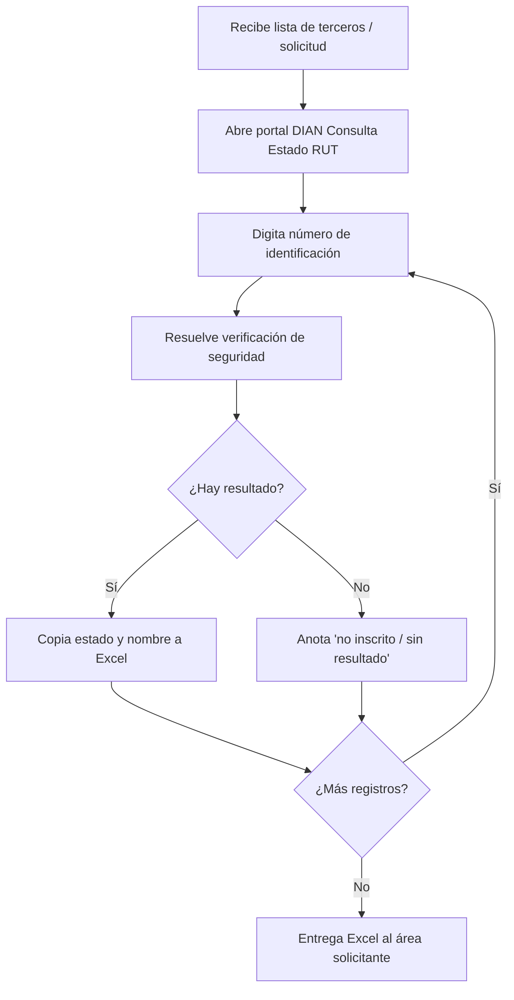

# Levantamiento de requisitos (Fase 1)

> Responsable de completar: agente `analista-requisitos` con respuestas del humano.
> Estado: **RONDA 1 COMPLETA — pendiente de aprobación del gate**

## AS-IS (proceso manual conocido)

## TO-BE (propuesto)

**Disparadores (frecuencia mixta):** (a) bajo demanda, al vincular un tercero o al recibir un lote;
(b) revalidación periódica de la base de terceros (periodicidad [PENDIENTE], ver RN-04).

## Actores

| Actor | Rol | Pendiente |
|---|---|---|
| Solicitante (compras, contratación, comercial/facturación, nómina) | Entrega identificaciones, recibe resultados | [PENDIENTE] nombre de las áreas |
| Operador | Ejecuta la herramienta, atiende pausas de captcha (modo asistido aprobado) | [PENDIENTE] quién |
| Administrador TI | Instala, configura, mantiene selectores | [PENDIENTE] |
| Responsable de datos personales | Aprueba finalidad y retención | [PENDIENTE] |

## Reglas de negocio

| ID | Regla | Estado |
|---|---|---|
| RN-01 | Solo dígitos; sin puntos, guiones ni espacios tras normalizar | [SUPUESTO] |
| RN-02 | Se aceptan cédulas y NIT. Si se recibe NIT con DV, se valida el DV antes de consultar | [CONFIRMADO] tipo · [SUPUESTO] validación DV |
| RN-03 | Estados válidos del RUT: los que muestre el canal oficial, sin reinterpretarlos | [PENDIENTE] Fase 2 (T-14) |
| RN-04 | Un resultado tiene validez de N días (define la periodicidad de revalidación) | [PENDIENTE] |
| RN-05 | Duplicados en un lote se consultan una sola vez | [SUPUESTO] |
| RN-06 | Los resultados se conservan 1 año y luego se eliminan | [CONFIRMADO] 2026-10-09 |
| RN-07 | Si el canal no está disponible y el tercero entregó copia del RUT, el operador puede validar contra ella (queda `PENDIENTE_VALIDACION_MANUAL` con observación). La copia debe tener ≤ 30 días; si es más antigua → `PENDIENTE_VALIDACION_MANUAL` con observación "copia vencida". El PDF no lo procesa la herramienta (ver INFORME-VIABILIDAD §8) | [CONFIRMADO] antigüedad ≤ 30 días (usuario, 2026-10-09) · la copia solo existe "a veces" |
| RN-08 | Sin convenio institucional ni presupuesto para proveedor. Fuente: copia del RUT del tercero (≤ 30 días) + contingencia manual como base; portal público "Consulta Estado RUT" vía RPA asistido solo si se cumplen las condiciones de INFORME-VIABILIDAD.md | [CONFIRMADO] 2026-10-09 (modificada en Fase 2) |

## Respuestas del responsable del requerimiento (2026-10-09)

| # | Pregunta | Respuesta | Clasificación |
|---|---|---|---|
| 1 | Finalidad / proceso | Vinculación y verificación tributaria de **proveedores, contratistas, clientes y empleados (nómina)** | [CONFIRMADO] |
| 2 | Campos | Estado del RUT, nombre / razón social, DV, fecha de consulta y fuente | [CONFIRMADO] |
| 3 | Tipo de identificación | Cédulas y NIT | [CONFIRMADO] |
| 4 | Volumen | 100 a 500 consultas/mes. Picos: [PENDIENTE] | [CONFIRMADO] rango |
| 5 | Frecuencia | Mixta: bajo demanda + revalidación periódica | [CONFIRMADO] |
| 6 | Destino | Excel (.xlsx) | [CONFIRMADO] |
| 7 | Copia del RUT del tercero | A veces | [CONFIRMADO] |
| 8 | Duración consulta manual | Más de 3 minutos. Quién y horas/mes: [PENDIENTE] | [CONFIRMADO] rango |
| 9 | Modo asistido ante captcha | Aceptable | [CONFIRMADO] |
| 10 | Retención | 1 año. Quién puede verlos: [PENDIENTE] | [CONFIRMADO] plazo |
| 11 | Presupuesto proveedor comercial | No | [CONFIRMADO] |
| 12 | Convenio con la DIAN | No; se usa el portal público. Se requiere **consulta masiva** (lotes) | [CONFIRMADO] |

**Fuera de alcance:** "Información reportada por terceros (exógena)" del portal transaccional Muisca.
Informa lo que terceros reportaron sobre la propia organización, requiere credenciales y no responde
al estado del RUT de terceros. [DESCARTADO] 2026-10-09.

**Nota sobre macros de Excel de terceros:** las herramientas que "se conectan a la web de la entidad"
no se reutilizan; su método (endpoints internos o evasión de captcha) se evalúa en Fase 2 (T-13) y
está restringido por CLAUDE.md §3.

### Preguntas abiertas (no bloquean el gate; quedan como supuestos)
- ¿Hay picos de volumen (cierre de mes, convocatorias)? → SUPUESTO: lote máx. 200 por ejecución.
- Periodicidad de revalidación (RN-04) → SUPUESTO: se decide en Fase 3; MVP solo bajo demanda.
- ¿Quién es el operador y quién puede ver los resultados? → SUPUESTO: área solicitante + operador.

## Indicadores (línea base por medir antes de calcular ahorros)

| Indicador | Manual (línea base) | Automatizado | Cómo se mide |
|---|---|---|---|
| Tiempo promedio por consulta | > 3 min (reportado); confirmar cronometrando 20 consultas | log `duration_ms` | cronómetro / log |
| % consultas completadas | — | `EXITOSA / total` | reporte de ejecución |
| % que requieren intervención | — | `REQUIERE_INTERVENCION_HUMANA / total` | reporte |
| Exactitud | — | muestra de 30 comparada contra pantalla | revisión manual |
| Horas operador / mes | > 5 h a > 25 h (100–500 consultas × > 3 min) [SUPUESTO derivado] | suma de `duration_ms` + pausas | log / encuesta |
