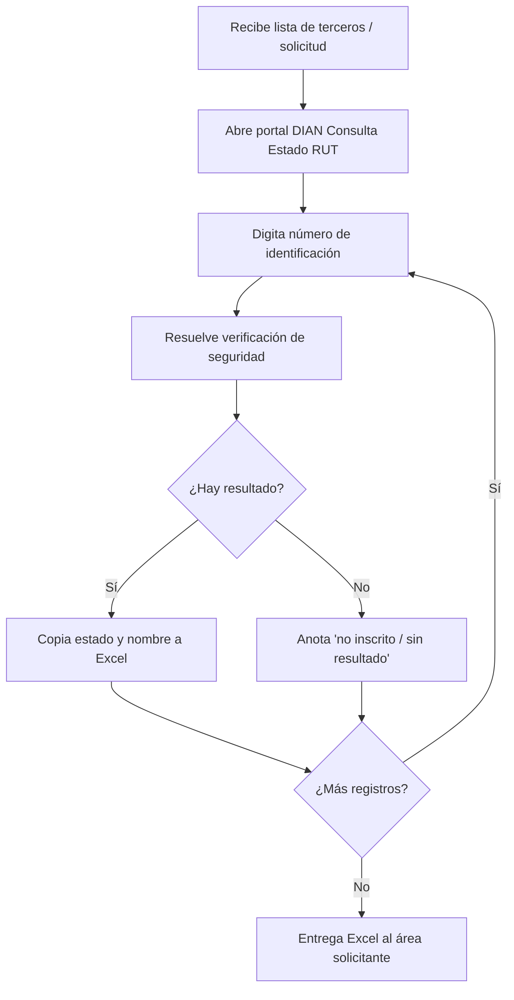
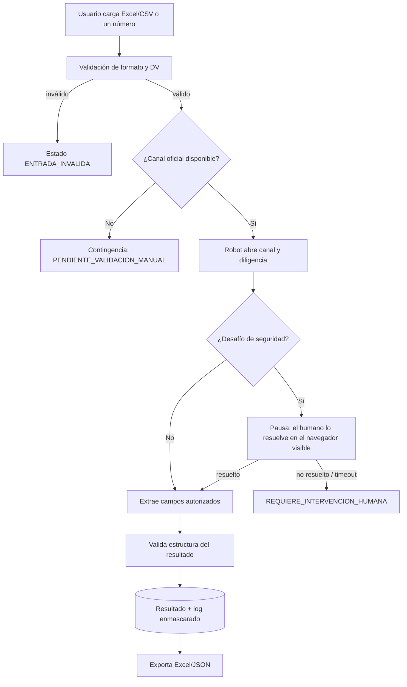

# Levantamiento de requisitos (Fase 1)

> Responsable de completar: agente `analista-requisitos` con respuestas del humano.
> Estado: **EN CURSO**

## AS-IS (proceso manual conocido)

## TO-BE (propuesto)

## Actores

| Actor | Rol | Pendiente |
|---|---|---|
| Solicitante (área de compras/contratación/contabilidad) | Entrega identificaciones, recibe resultados | [PENDIENTE] nombre del área |
| Operador | Ejecuta la herramienta, atiende pausas de captcha | [PENDIENTE] |
| Administrador TI | Instala, configura, mantiene selectores | [PENDIENTE] |
| Responsable de datos personales | Aprueba finalidad y retención | [PENDIENTE] |

## Reglas de negocio

| ID | Regla | Estado |
|---|---|---|
| RN-01 | Solo dígitos; sin puntos, guiones ni espacios tras normalizar | [SUPUESTO] |
| RN-02 | Si se recibe NIT con DV, se valida el DV antes de consultar | [SUPUESTO] |
| RN-03 | Estados válidos del RUT: los que muestre el canal oficial, sin reinterpretarlos | [PENDIENTE] |
| RN-04 | Un resultado tiene validez de N días | [PENDIENTE] |
| RN-05 | Duplicados en un lote se consultan una sola vez | [SUPUESTO] |

## Preguntas para el responsable del requerimiento

1. ¿Para qué proceso se usa la consulta (vinculación de proveedores, contratistas, clientes, nómina)? Define la finalidad legal del tratamiento.
2. ¿Qué campos necesitan exactamente? ¿Solo estado (activo/suspendido/cancelado) o también nombre y DV?
3. ¿Cédulas de personas naturales, NIT de empresas o ambos?
4. Volumen: ¿cuántas consultas por día/semana/mes? ¿Picos (cierre de mes, convocatorias)?
5. Frecuencia: ¿bajo demanda, diaria programada, al vincular un tercero?
6. ¿Dónde debe quedar el resultado? (Excel, SharePoint, ERP SAP/Odoo, base de datos)
7. ¿Existe ya una copia del RUT entregada por el tercero que pueda servir como validación documental?
8. ¿Cuánto tarda hoy una consulta manual (línea base)? ¿Quién la hace y cuántas horas al mes?
9. ¿Es aceptable un modo asistido (el operador resuelve la verificación de seguridad cuando aparezca)?
10. ¿Cuánto tiempo deben conservarse los resultados? ¿Quién puede verlos?
11. ¿Hay presupuesto para un proveedor comercial si resulta la vía más estable?
12. ¿La organización tiene convenio o canal institucional con la DIAN?

## Indicadores (línea base por medir antes de calcular ahorros)

| Indicador | Manual (línea base) | Automatizado | Cómo se mide |
|---|---|---|---|
| Tiempo promedio por consulta | [PENDIENTE medir 20 consultas] | log `duration_ms` | cronómetro / log |
| % consultas completadas | — | `EXITOSA / total` | reporte de ejecución |
| % que requieren intervención | — | `REQUIERE_INTERVENCION_HUMANA / total` | reporte |
| Exactitud | — | muestra de 30 comparada contra pantalla | revisión manual |
| Horas operador / mes | [PENDIENTE] | — | encuesta |
